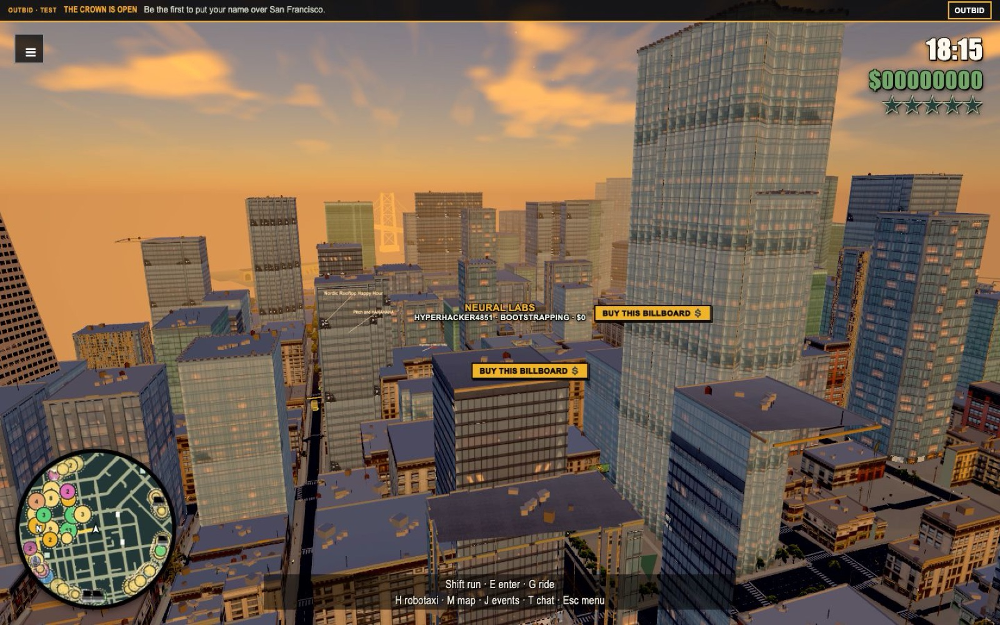
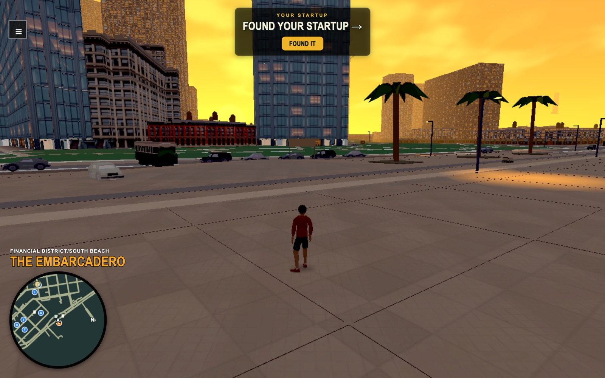
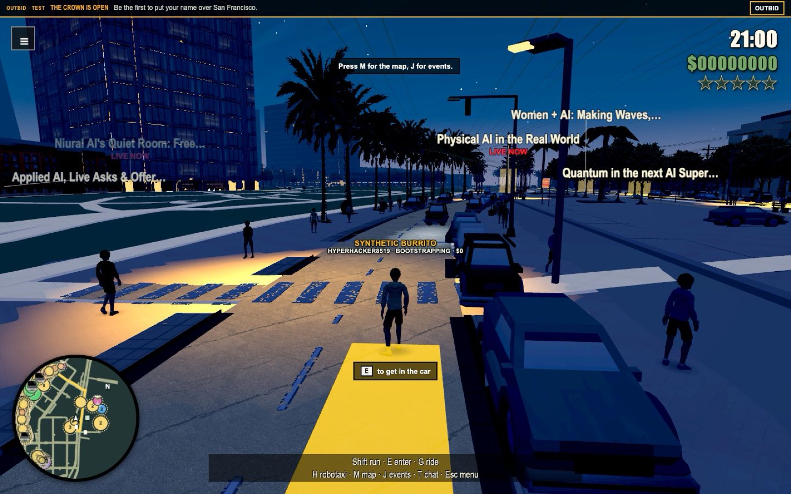

# Grand Tech Auto: San Francisco



**A browser multiplayer GTA-style game set in real San Francisco, where you found a startup, pitch investors and drive the Lombard hills.** Plain three.js and TypeScript on Cloudflare (Workers, Durable Objects, D1, R2). Play it at **[gtasf.com](https://gtasf.com)**.

| | |
|---|---|
|  |  |

- Real roads, terrain and buildings baked from open map data (OSM, DataSF, USGS 3DEP LiDAR).
- Walk, drive, hail an autonomous robotaxi, and see real Tech Week events on the radar.
- A "founder ladder": found a startup, buy a billboard, pitch real-named VC firms for fictional funding.
- Multiplayer: two tabs see each other in the same city.
- Built in about three weeks by one person directing a swarm of AI coding agents.

> **Unofficial parody.** "Grand Tech Auto" is a parody project and is **not affiliated with, endorsed by or connected to Rockstar Games or Take-Two Interactive.** Company and person names (VC firms, angel investors, event hosts) are used for satire and are fictional in behaviour. Open an issue for takedown requests.

> **Assets not included.** To keep this repository free of paid and generated third-party assets, the following are omitted: Meshy-generated characters and vehicles (`web/public/assets/{avatars/meshy-*,vehicles-pbr,facades-pbr}`), Scenario/fal-generated art (`web/public/art/{props,foliage,billboards,facades,loading,ground}`), and the generated genre-radio tracks. Code that loads them falls back or logs a missing file; supply your own to restore the look. See [ASSETS.md](ASSETS.md) and [PROVENANCE.md](PROVENANCE.md). Code is MIT-licensed; some data is under its own licence (OpenStreetMap ODbL).

## About this repository
This is a one-off public snapshot of the project, published without its internal planning notes, deployment runbooks, work-tracker history and large screenshot archives. Some paths mentioned in the docs below refer to files that are not in this snapshot.

## Play locally

```sh
npm run dev
```

Open **http://127.0.0.1:5173**. The launcher uses the installed Node 24.21.0 runtime, seeds the real Tech Week event snapshot and starts local Wrangler on 8787 plus Vite on 5173. No secrets are needed for this local build. On a fresh checkout, run `nvm install && nvm use && npm ci` first and follow [the map setup](tools/map/README.md) to generate the ignored map assets. The current workspace already has those assets.

You arrive on the Ferry Building plaza facing its clock tower, beside a parked car. Use the arrow keys to look and C to recenter; mouse look is optional (click the scene). Two tabs share the same local city.

| Action | Control |
| --- | --- |
| Walk / steer and accelerate | WASD |
| Orbit / pitch camera | Left-right / up-down arrow keys |
| Recenter the chase camera | C |
| On-foot movement setting | Camera relative by default; use the On foot button to switch to tank controls |
| Run on foot | Shift |
| Enter / exit the nearby car | E or the Enter / exit button |
| Brake / reverse | S |
| Handbrake | Space |
| Hail / cancel an autonomous robotaxi | H or the Hail button |
| Browse upcoming events | V or the Upcoming events button |
| Open the event map | M or the Map button |
| Share your location | L or Share location |
| Release the mouse / close map | Escape |

The chase camera swings behind you after 1.5 seconds without camera input and pulls back with driving speed. Choose Lombard or Ferry Building using the quick destination buttons, browse upcoming Tech Week events with V, or select a location on the map. Selecting an event draws its road route on the radar and ground, shows remaining distance and estimated travel time, and opens its card on arrival. The events view includes Live now, Today, Tomorrow and the next seven days, search, and a per-event hail action. The taxi route follows the waterfront and North Beach to Lombard. Phones have touch movement/look controls and action buttons; gamepads use sticks, triggers and face buttons.

The Outbid banner opens the cumulative paid leaderboard and bid form. It shows confirmed server totals and forwards the same approved winner to the Salesforce Tower crown. An empty leaderboard stays empty; test Checkout remains unavailable until the GTASF payment and moderation providers are configured.

Choose a startup name and nickname when you first arrive. Enter an event's glowing marker on foot and stay for 20 seconds to raise fictional funding; leaving early cancels the attempt. The server records your awards, round and leaderboard rank across reloads. The funding panel shows your startup and the weekly and daily leaderboards. Event cards have a Share event button that copies a direct game link; their RSVP buttons still open the source event page.

[Open the top of Lombard](http://127.0.0.1:5173/go/lombard) for a shorter driving playtest. Location links accept `?at=latitude,longitude[,heading]`, where heading is compass degrees (north 0, east 90), or `/go/<slug>` for a named landmark, event ID/source slug or registered office. They load the destination chunk behind a loading card and place you on a clear road. Share links include the current position and heading. Locations outside the generated corridor report that the area is unavailable.

## Current scope and checks

The local build includes real hills and detailed building facades, a rigged avatar, parked SF cars, driving, autonomous taxis, event radar and GPS, landmark models, street props, road markings and shared player presence. An invite-gated playtest is deployed at [gtasf.pages.dev](https://gtasf.pages.dev); see [DEPLOY.md](DEPLOY.md) for access and deployment details. The local build can be ahead of that deployed revision. Full-city coverage, paid billboard checkout and later staging/device/performance gates remain separate work. Local referral sharing and warm introductions are enabled: Share and earn 20% shows your own link and server counters, and a referred friend who plays five minutes earns you $100k of fictional funding. Email claims, referral checkout credit and cash-out stay disabled pending provider setup; see [the referral programme](docs/referrals.md). `shared/flags.ts` records enabled entry points. Protocol `gtasf.v2` uses signed centimetres on the wire; world coordinates are metres, +x east / +y up / -z north.

Use one browser smoke per feature through the founder's local playtest milestone. With the dev server running, `node tools/playable-smoke.mjs` checks arrival, coordinate/named links, sharing and map input. `node tools/playable-movement-check.mjs` exercises walk, drive and taxi movement. Ignored screenshots and reports go under `artifacts/`. Only run scoped workspace typechecks or affected tests; avoid full-repository checks on the shared laptop. `npm run check` is reserved for a later coordinated gate.

The terrain/road handoff and route limitations are documented in [LOCAL-PLAY.md](tools/map/LOCAL-PLAY.md). Map output and downloaded source caches stay ignored. OSM attribution and CC0 credits are retained in the map manifest and PROVENANCE.md. The event snapshot is a public-source local dataset; live refresh and credentials are configured separately.

## Data and deployment

No external fetch runs at game boot. The launcher imports the checked-in event snapshot into local D1. Wrangler configuration uses GTASF resources only; staging provisioning, domain setup and secrets have their own beads. Never copy BDTS credentials. Keep `.dev.vars` and provider keys out of Git.
